# Days Left

### A short book about time, attention, and a phone that does the waiting for you

*Written as principles, because a codebase is only a pile of decisions, and decisions are easier to remember than code.*

---

## Contents

| | |
|---|---|
| **I.** | [The premise](#i-the-premise) |
| **II.** | [What it is](#ii-what-it-is) |
| **III.** | [Countdowns: the honest clock](#iii-countdowns-the-honest-clock) |
| **IV.** | [The library: reading and listening, together](#iv-the-library-reading-and-listening-together) |
| **V.** | [The hard problem](#v-the-hard-problem) |
| **VI.** | [Listen to less, know more](#vi-listen-to-less-know-more) |
| **VII.** | [The machinery of matching](#vii-the-machinery-of-matching) |
| **VIII.** | [Accuracy is a refusal](#viii-accuracy-is-a-refusal) |
| **IX.** | [Everything runs in the background](#ix-everything-runs-in-the-background) |
| **X.** | [The shape of the system](#x-the-shape-of-the-system) |
| **XI.** | [Shipping: one key, forever](#xi-shipping-one-key-forever) |
| **XII.** | [How we know it works](#xii-how-we-know-it-works) |
| **XIII.** | [The numbers](#xiii-the-numbers) |
| **XIV.** | [Mistakes, kept on purpose](#xiv-mistakes-kept-on-purpose) |
| **XV.** | [What is not proven](#xv-what-is-not-proven) |
| **XVI.** | [Build it, run it](#xvi-build-it-run-it) |
| **XVII.** | [The map of the repo](#xvii-the-map-of-the-repo) |
| **XVIII.** | [Rules we keep](#xviii-rules-we-keep) |

---

## I. The premise

Time is the one asset you cannot earn more of. Everything else is a trade for it.

Most apps trade your time for their metrics. This one does the opposite: it shows you how much time is left, then helps you spend it on the few things worth finishing.

**Three beliefs hold the whole thing up.**

1. **Attention is the scarce thing, not information.** There are more books than you will ever read. The work is choosing, then finishing.
2. **Leverage means doing something once instead of forever.** A computer can wait. You should not. Anything slow belongs in the background, where the cost is paid by a processor and not by a person.
3. **Specific knowledge beats generic features.** This app knows one problem very well: *"I have a deadline, a book, and an audiobook of the same book. Help me finish."* It does not try to be anything else.

```
        what you have                      what you want
   ┌──────────────────────┐          ┌───────────────────────┐
   │  a deadline          │          │  to finish            │
   │  a book (PDF)        │   ───►   │  to understand        │
   │  its audiobook (m4a) │          │  without babysitting  │
   │  a few spare minutes │          │  a tool                │
   └──────────────────────┘          └───────────────────────┘
                     the app is the arrow
```

> Cheap tools ask for your attention. Good tools return it.

---

## II. What it is

Two products share one shell. They share it because they share a question: *how much is left, and what do I do with it?*

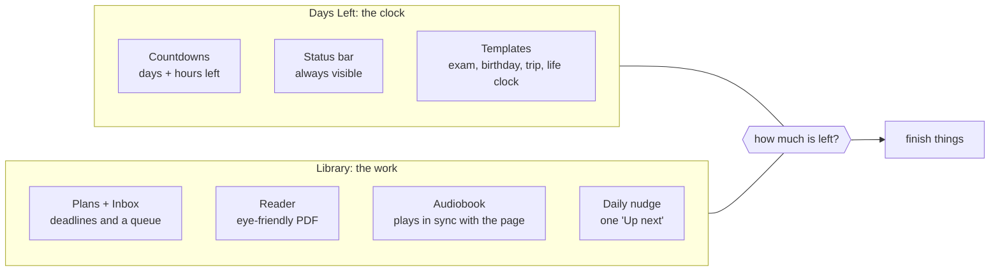

**Everything is plain.** Plain Java. Plain Android views, built in code. No androidx, no UI framework, no analytics, no account, no server. One native library (a speech recogniser) and one Java dependency (a PDF text reader).

| Constraint | Why |
|---|---|
| No account, no cloud | Nothing to leak, nothing to shut down, nothing to pay for. |
| Everything on the device | Your books and your voice recordings stay yours. |
| No UI library | Fewer moving parts. The whole UI is one language you can read in an afternoon. |
| Minimal permissions, asked at the moment they matter | Trust is built by asking late and explaining why. |

---

## III. Countdowns: the honest clock

A countdown is the simplest honest object in software: a date, and the distance to it.

**What you can do**

- Put **days and hours left** in the status bar, as a pinned notification, so the number follows you everywhere.
- Start from a **template**: Exam, Birthday, Until we meet, Anniversary, Trip, Goal, Life clock, or Custom.
- **Repeat every year** for birthdays and anniversaries.
- Decide **what happens when it ends**: show "✓ Completed", keep counting up ("3 days since"), or remove itself.
- Show an optional **large text overlay**, sized like the clock, for phones that shrink status icons.
- Get a **finish alert**, and survive reboots: the countdown restarts itself.
- See **how far along you are** between a start date and the target.

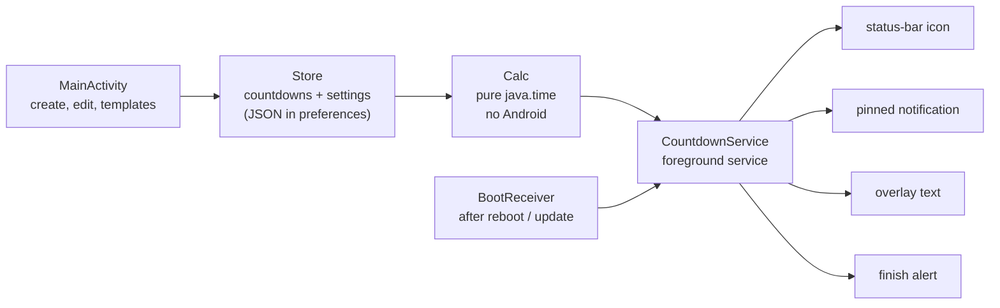

> Put the maths in a file that knows nothing about phones. It will still be right when the phone changes.

`Calc` is deliberately boring: dates in, numbers out. That is why it has tests, and why it never surprises you.

---

## IV. The library: reading and listening, together

A countdown tells you the deadline. The library is where the deadline gets met.

**Plans and Inbox.** A *plan* is a group of items under a deadline. The *Inbox* is everything with no deadline yet. Share a link or a file into the app and it lands in the Inbox. Items can be a book, audiobook, podcast, video, article, or other.

**The daily nudge.** Once a day, at an hour you choose, one notification: *"Up next: …"*. Planned items come first, soonest deadline wins. Then the oldest thing waiting in the Inbox. One thing. Not a list.

**The reader.** An eye-friendly PDF reader: warm paper themes, adjustable text, no glare at night.

**The audiobook.** An m4a, m4b or mp3 plays through a media-style foreground service, so it keeps going with the screen off and has proper notification controls.

**The part that took the most work: the two stay together.**

| You do | The app does |
|---|---|
| Press play on a book that isn't synced | Asks once, explains the benefits, and starts mapping in the background. |
| Listen | Highlights the sentence being read. Turns the page for you (if you want). |
| Tap **Find page** | Tells you which page the narrator is on. |
| Tap **Play page** | Finds where this page is spoken, and starts playing there. |
| Pin a page | Stores a manual anchor. Pins always win. |
| Jump somewhere far | Maps the new place in about a minute and goes on. |

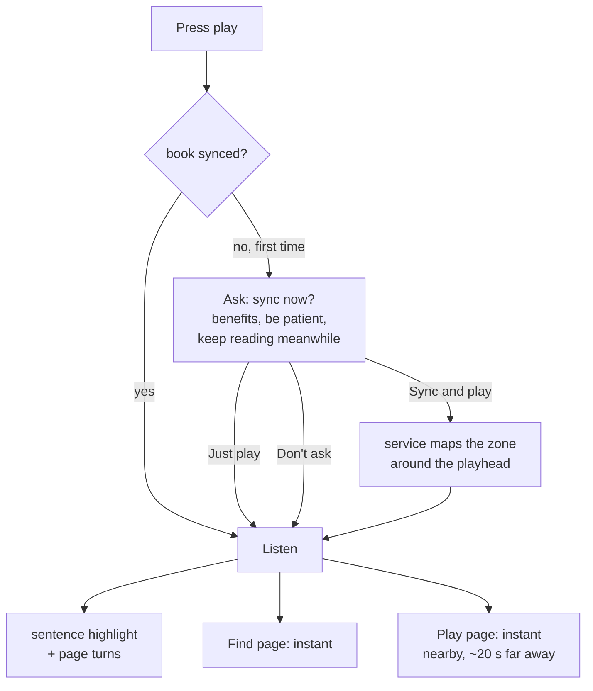

> The best interface is a fact that is already true when you look at it.

---

## V. The hard problem

Here is the problem in one sentence: **to highlight a sentence while the narrator speaks it, the phone must know *when* every word of a 9.7-hour recording is spoken.**

The obvious method is to transcribe the whole thing with a speech recogniser and match it to the book. It works. It is also **slow**: on a mid-range phone, a recogniser runs at roughly real time. Nine hours of audio costs hours of waiting.

```
  transcribe everything               what we actually need
  ─────────────────────               ─────────────────────

  |████████████████████████|  9.7 h   |      ▮▮▮    ▮▮▮    |  seconds
   every second heard                    only around the playhead
   wait: hours                           wait: ~30 seconds
```

**The insight.** The narrator's pace is steady. If you know *where* two moments are, you can estimate everything between them. You do not need to listen to the whole book. You need to listen to **a few short samples**, place them precisely in the text, and *interpolate*.

> Do not solve the whole problem. Solve the part that is in front of you, and be ready to solve the next part before you get there.

There are three jobs, and each has its own tool:

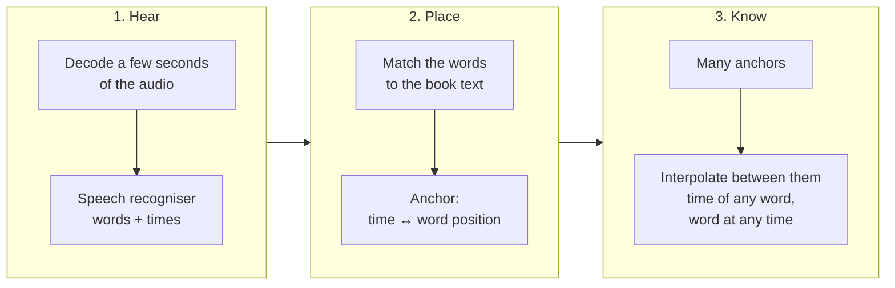

---

## VI. Listen to less, know more

The planner decides *which few seconds* to listen to. It is the brain; everything else is plumbing.

### The zone

Around the playhead there is a **zone**: a little behind, a lot ahead. Inside the zone, anchors must be close together, because that is where the highlight lives. Outside the zone, they can be far apart, because only a page number is needed.

```
 time ──────────────────────────────────────────────────────────────────────►

                      40 s            playhead                150 s
                     behind             ▼                     ahead
   ·········  ·····  ▮▮▮  ▮▮▮  ▮▮▮  ▮▮▮▮▮  ▮▮▮  ▮▮▮  ▮▮▮  ▮▮▮  ····  ·········
              coarse ◄──────── DENSE ZONE: a probe every ~20 s ───────► coarse
              (gaps ≤ 90 s)           (highlight lives here)           (gaps ≤ 90 s)

   ▮ = a 9-second probe, placed exactly in the book text
   the zone slides with you, at the speed you listen
```

### The order of work

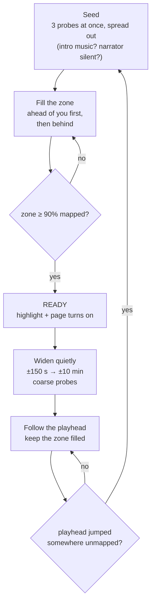

### Three questions in one call

A speech model has a **fixed overhead per call**. So each call carries *three* short clips spliced into one window, separated by a second of silence. One call, three answers. Word-level timestamps tell the clips apart.

```
  one speech call
  ┌──────────────────────────── 30 s window ────────────────────────────┐
  │ ▮▮▮▮▮▮▮▮▮ clip A │ 1 s │ ▮▮▮▮▮▮▮▮▮ clip B │ 1 s │ ▮▮▮▮▮▮▮▮▮ clip C │
  └─────────────────────────────────────────────────────────────────────┘
        ▼                          ▼                          ▼
     words + times            words + times             words + times
        (A)                       (B)                       (C)
```

### Locating a page you have never heard

*Play page* far away is a **search**: where in 9.7 hours is the first word of page 174?

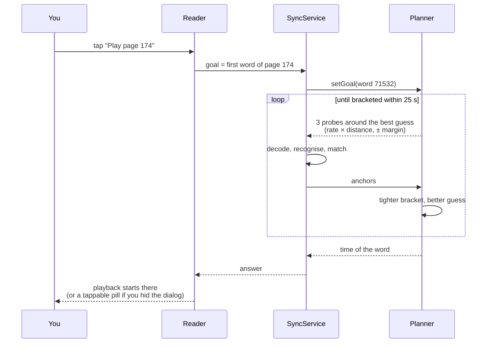

Each round **shrinks the uncertainty by roughly an order of magnitude**: from a guess good to ±30 minutes, to ±1 minute, to ±5 seconds. Three rounds, typically. If you rest on a page for a moment, the app **starts that search before you ask**. When you tap, it is already answered.

> Prediction is what you do when you cannot afford to wait. Prefetch is prediction with a deadline.

---

## VII. The machinery of matching

Hearing gives words. Placing them in the book is a different problem, and the one most likely to be quietly wrong.

### Bigrams vote

Every pair of neighbouring words is a fingerprint. Rare pairs are strong evidence; common pairs ("of the") are weak. Each matched pair in the book *votes* for where the speech is. The votes must agree on one place.

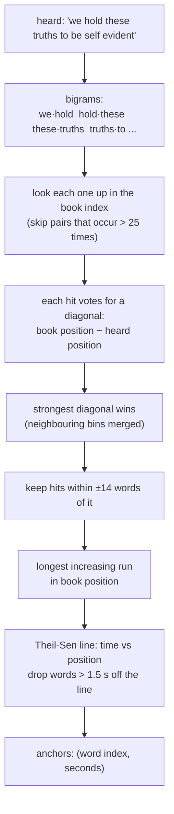

### Why each step exists

| Step | The failure it prevents |
|---|---|
| **Skip very common pairs** | "of the" matches a thousand places and proves nothing. |
| **Vote on a diagonal** | Real speech moves through the book at a steady offset. Coincidences do not line up. |
| **Longest increasing run** | Speech only moves forward. A match that jumps backward is wrong. |
| **Tight search window** | The planner knows roughly where the clip should land. Searching only there stops a repeated phrase elsewhere from winning the vote. |
| **Theil-Sen straight line** | Over nine seconds, pace is constant. A word that falls off the line is a false match. The median slope ignores a few liars. |
| **Neighbour consistency** | A new anchor must agree, in order, with the anchors beside it. |

### The alignment: two sorted arrays

The result is two arrays, `word[]` and `time[]`, sorted together. Every question is a binary search plus one line of arithmetic.

```
   time:   10.2   11.9   13.0   14.6  ......  34.1   35.9
   word:   2310   2316   2322   2327  ......  2398   2406
                    ▲
   "what word at 12.4 s?" ──► between anchors 2 and 3 ──► linear interpolation ──► word 2319
```

Microseconds per lookup. That is why the highlight feels free: all the cost was paid earlier, somewhere you could not see it.

### Pauses lie

Narrators pause. Chapters end. Music plays. Across a pause, linear interpolation is *wrong*: two anchors ten seconds apart may hold only eight words, not twenty-eight.

The system measures the narrator's **usual pace** from anchors that are close together. If the gap between two anchors implies less than **55% of that pace**, the gap contains a pause: **the highlight is refused there**, and the planner sends a probe *into* the gap to look.

```
      anchor A ●────────────  8 words in 10.8 s  ────────────● anchor B
                          ▲
             usual pace says ~28 words. Only 8.
             ⇒ there is a pause in here. Do not guess. Look.
```

---

## VIII. Accuracy is a refusal

**A wrong highlight is worse than no highlight.** It teaches you to stop trusting it, and then every right answer is wasted.

So the app is built around *knowing when it does not know*.

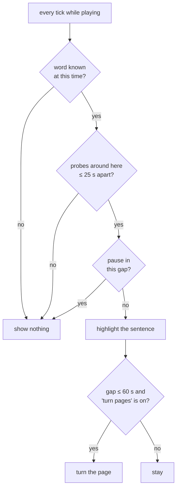

| Feature | Needs | Why |
|---|---|---|
| **Sentence highlight** | probes ≤ 25 s apart, no pause | a sentence lasts 5–8 s; error must be ≪ that |
| **Automatic page turn** | probes ≤ 60 s apart | a page lasts about a minute; error can be larger |
| **Play page start** | bracketed by probes ≤ 25 s apart | you should land at the top of the page, not mid-paragraph |
| **"Ready"** | ≥ 90% of the zone mapped (off below 60%) | the label must be the truth, even after a jump |

**"Ready" is not a feeling.** It is re-measured every loop, with *hysteresis*, so it never flickers and never lies. After a jump, it switches off by itself and tells you the real progress.

> Confidence is a number you compute. Not a mood you project.

---

## IX. Everything runs in the background

You should never have to *watch* the app work.

**The rule:** nothing may depend on the reader screen being open. Close it. Lock the phone. Open a different app. The work continues, and the results are waiting.

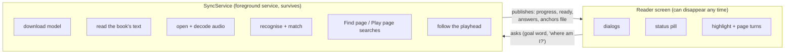

The two sides never share objects, only a few published values and a file on disk:

| Published by the service | Meaning |
|---|---|
| `dlPct` | model download progress, 0–100, or −1 |
| `textPct` | book text reading progress, or −1 |
| `anchorCount` | 0 means still finding your place |
| `ready` | the zone around you is mapped |
| `goalTimeOut` | answer to "when is this word spoken?" (−1 working, −2 not found) |
| `hereWord` | the book word at the playhead |
| anchors file | the durable memory: every anchor ever found |

Every wait dialog has **Hide** and **Cancel**. *Hide* keeps working; the answer comes back as a tappable pill. *Cancel* stops. They are different promises, and the screen says which is which.

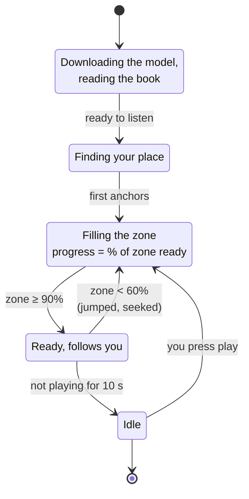

The notification, the pill and the dialog all read **one function** for wording and one for the number. They cannot disagree, because there is only one of them.

---

## X. The shape of the system

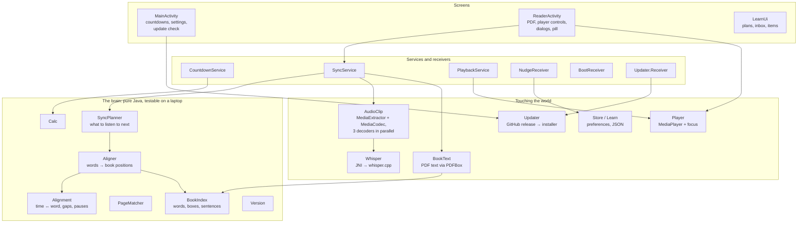

**The principle behind the split:** everything that *decides* is pure Java with no Android in it, so it runs in a simulator on a laptop in seconds. Everything that *touches the world* is thin and checked on a real device. If a bug lives in the brain, you can reproduce it at your desk.

### What lives on disk

```
  files/
  ├─ al_<item>.bin        anchors: (word index, seconds), appended as found
  ├─ book_<item>.bin      the book's words, page starts, per-word boxes, sentence ends
  ├─ ggml-tiny.en-q5_1.bin     the speech model (about 30 MB)
  └─ (optional) ggml-base.en-q5_1.bin   a more careful, slower model (about 56 MB)

  preferences
  ├─ countdowns, plans, items, settings (JSON)
  ├─ per book: wanted?, ready?, last progress, "don't ask again"
  └─ per device: best thread count (measured), word-timestamp mode on/off
```

> Memory should be append-only. You can always replay it. You can never un-lose it.

---

## XI. Shipping: one key, forever

An app that updates itself is a promise: *the next version will install over this one.* That promise depends on one fact, and only one: **every release is signed by the same key.**

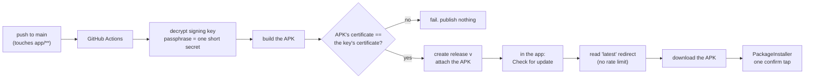

**How the in-app update works**

1. It asks the public "latest release" page which tag is newest. (The web redirect has no rate limit; the API does, and mobile networks share addresses.)
2. If the tag is newer than the installed version, it shows the notes and downloads the APK.
3. It hands the file to Android's installer through a session. One tap to confirm.
4. The installer's answer comes back to a receiver that is addressed by class, because an implicit address would silently never arrive.

**How the key is protected.** The keystore is committed *encrypted* (AES-256, PBKDF2, 300,000 iterations). The passphrase is a short repository secret. A short secret survives being typed on a phone. A 3,500-character blob does not.

> Make the dangerous thing impossible, not discouraged. The build refuses to publish a wrongly-signed APK. No one has to remember to check.

---

## XII. How we know it works

You cannot test a phone from a laptop. You can test everything *except* the phone, and then be honest about the rest.

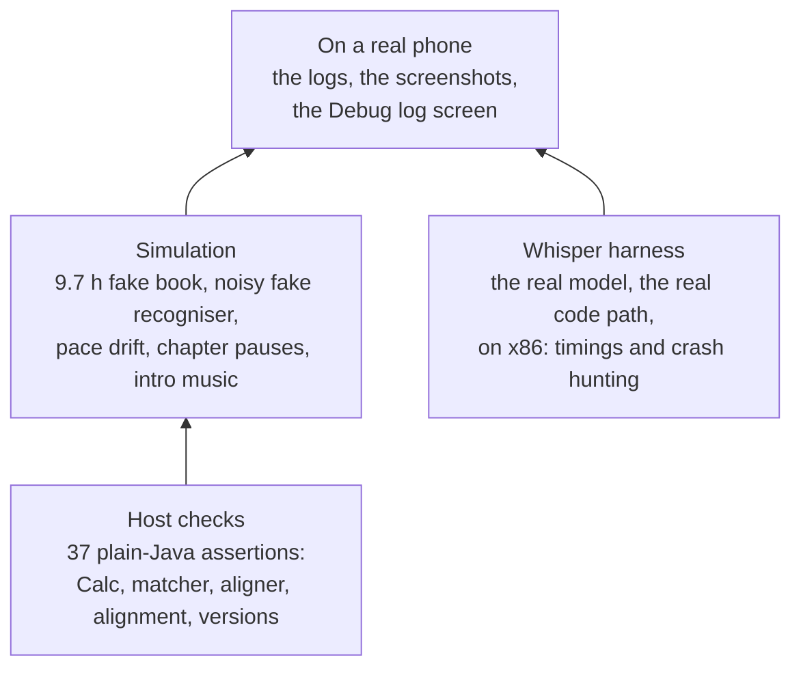

**The simulation** models the things that broke the real thing: a narrator whose pace drifts, a recogniser that drops 5% of words and invents 12%, a 30-second intro, an 8-second pause at every chapter, and the cost of a speech call measured on a real phone. It reports what the user would feel:

```
  press play on an unsynced book
    first highlight .......... ~1 call after the seed
    highlight available ...... 99% of the time
    wrong (> 2.5 s) .......... 0 of 467 shown
    median error ............. 0.30 s      95th percentile ... 0.85 s

  jump far with "Play page", keep listening
    highlight available ...... 100% of the time   (it was 10% before the fix)

  Play page from nothing .... within 1 s, ~3 speech calls
  Play page nearby .......... instant
```

**Every bug found on the phone becomes a test first.** Two examples: after a far jump the highlight was lost, and the simulation reproduced it (10% available) before the fix and confirmed it (100%) after. Widening the mapped window silently did nothing, and the "two rings" check now fails if it ever does again.

| Command | What it does |
|---|---|
| `tests/host/run.sh` | the 37 plain-Java checks |
| `tests/host/simrun.sh` | the full simulation (`JOPTS="-Ddn=16 -Dna=100"` sweeps spacing) |
| `tests/host/whisper/` | builds the vendored recogniser on a laptop, times it, hunts crashes |

---

## XIII. The numbers

Measured on a mid-range 2023 phone (8 cores, 5.5 GB RAM), tiny English model, with a real 9.7-hour audiobook and a 241-page, 95,000-word PDF.

| Thing | Cost |
|---|---|
| One speech call | about **2.0 s + 0.17 s** per second of audio in the call |
| One call with three 9-second clips | about **6–7 s** |
| Decoding one clip (kept-open decoder) | about **0.9 s** |
| Opening a 9.7 h m4a the first time | about **10 s** (so it is done in the background, early) |
| Reading a 241-page PDF's text | about **45–50 s**, once per book |
| Speech model download | about **30 MB**, once |
| Whole book, listened to completely | roughly real time: **hours** |
| Zone around the playhead, ready | roughly **30 s** end to end |

```
  cost of finding out where a sentence is
  ───────────────────────────────────────
  transcribe everything   ████████████████████████████████████████  hours
  sample + interpolate    █                                         ~30 s
```

The zone is about 190 seconds wide and costs about nine probes. Probes shorter than nine seconds did not help: you pay a fixed price per call, and short probes carry too few words to match reliably.

---

## XIV. Mistakes, kept on purpose

A good record of mistakes is worth more than a good record of successes. These are real, and each cost real time.

| What went wrong | What it looked like | The cause | What we did |
|---|---|---|---|
| **Every release had a different key** | "App not installed: package conflicts with an existing package" | The CI quietly ignored the signing secret and generated a random key per build. | Explicit signing config. The release now **fails** if the key doesn't match. |
| **The signing secret was corrupt** | The build said "not a valid keystore" | A 3,500-character secret pasted from a phone. | Keystore committed encrypted; the secret is a short passphrase. |
| **Update downloaded, then nothing** | "Downloaded. Confirm the install…" and silence | The installer's reply was addressed in a way the manifest never matched. | Address the receiver by class. |
| **"GitHub answered 403"** | The update check failed | The unauthenticated API allows 60 requests per hour per address, and mobile networks share addresses. | Read the public "latest" redirect instead. |
| **Play button did nothing** | It started, then paused silently | A new audio-focus request on every play told the previous request "you lost focus," and its listener paused the player. | One focus request for the player's whole life. |
| **Sync only ever mapped ±150 s** | Highlight vanished after a few minutes | Widening the window never reopened the two directions that had been marked finished. | `widen()` resets them; a simulation check guards it. |
| **Highlight lost after a far jump** | "Find page" waited 45 s | The cursors stayed where they were before the jump, mapping the wrong minutes. | Re-place them when the playhead leaves their stretch. |
| **Wasted minutes bisecting a gap** | Six calls listening to nothing useful | A far search left a 26,000-second gap between two islands, and the planner tried to fill it. | Gaps over 300 s are islands, never refined. |
| **A 7.8-second wrong highlight** | The simulation found it | Interpolating across an 8-second chapter pause. | Detect pauses by pace; refuse to highlight inside them. |
| **"Synced" next to "15%, 1 h 41 min left"** | The app contradicted itself | "Ready" was set once and never re-checked; the estimate counted from service start. | Ready is re-measured with hysteresis; one function for all wording; the estimate restarts on every change. |
| **Opening the audio took 13.8 s of a 21 s call** | Slow first highlight | A 10-hour file takes ~10 s to open, and it was opened late. | Open it early, in parallel, and keep it open. |

> Fix the class of bug, not the instance. Then make the class impossible.

---

## XV. What is not proven

Honesty is a feature. These are the edges of what has been verified.

- **A native crash** was seen once in an earlier recognition path on the phone. It did not reproduce on a laptop for any setting, so it is likely specific to the phone's processor. The current path avoids it. Word-level timestamps are protected: if the app ever dies inside such a call, it turns them off for good and falls back.
- **The simulation is a model.** Real speech has stranger errors than a random 12%. The thresholds (spacing, gap limits, pause detection) are tuned on the simulation and on a small number of real logs.
- **Parallel decoding and the early file open** are implemented and measured in logs from before the change. Their effect on the phone has not yet been logged.
- **Battery saver** slows the processor. The app says so while it works; it does not change the physics.
- **Scanned PDFs** have no text to match. The app detects them and says so.
- **Different editions** (abridged audio, different text) will have gaps. The app prefers silence over a wrong guess.

---

## XVI. Build it, run it

**You need:** JDK 17, the Android SDK (platform 36, build-tools, NDK 27.2, CMake 3.22.1), and `ANDROID_HOME` set.

```bash
# build
./gradlew assembleDebug            # or:  gradle assembleDebug --no-daemon -q
# the APK
app/build/outputs/apk/debug/app-debug.apk

# test (no phone needed)
tests/host/run.sh                  # plain-Java assertions
tests/host/simrun.sh               # the simulation: highlight availability, error, page search
```

**What gets built.** Java for the app, plus one native library (`dayswhisper`) that wraps the vendored `whisper.cpp`, compiled for `arm64-v8a` only.

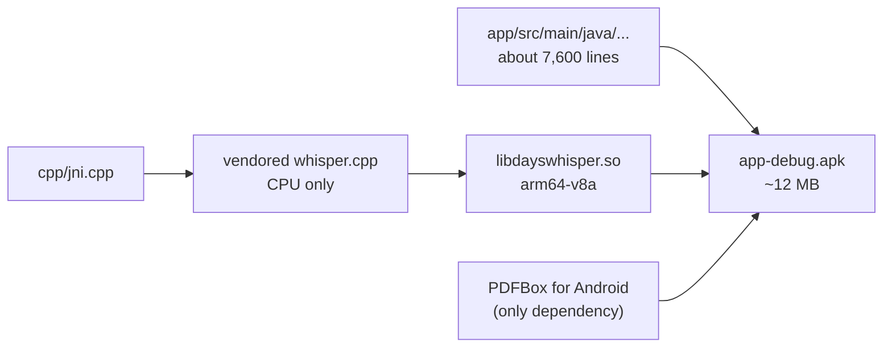

**Release.** Bump `versionCode` and `versionName` in `app/build.gradle`, push to `main`. CI does the rest. The first install of a new signing key must be a manual, uninstalled install. After that, **Settings → System → Check for update** does everything.

---

## XVII. The map of the repo

```
.
├─ README.md                    this book
├─ CLAUDE.md                    notes for whoever (or whatever) edits the code next
├─ app/
│  ├─ build.gradle              versions, explicit signing, one dependency
│  └─ src/main/
│     ├─ AndroidManifest.xml
│     ├─ cpp/                   jni.cpp + vendored whisper.cpp
│     └─ java/com/taiyeb/daysleft/
│        ├─ Calc, Store, CountdownService, BootReceiver     the clock
│        ├─ Learn, LearnUi, NudgeReceiver                   plans, inbox, daily nudge
│        ├─ ReaderActivity, Player, PlaybackService         the reader and the audio
│        ├─ BookText, BookIndex, PageMatcher                the book as data
│        ├─ SyncService, SyncPlanner, Aligner, Alignment    the sync brain
│        ├─ AudioClip, Whisper                              hearing
│        ├─ Updater, Version                                updating itself
│        └─ App, Dbg                                        crash + debug log
├─ signing/dl.keystore.enc      the signing key, encrypted
├─ .github/workflows/release.yml  build, sign, verify, publish
└─ tests/host/
   ├─ HostTests.java, run.sh    37 plain-Java checks
   ├─ SyncSim.java, simrun.sh   the simulation
   └─ whisper/                  harness for the real recogniser on a laptop
```

---

## XVIII. Rules we keep

1. **Plain Java, no androidx, views built in code.** Fewer parts, fewer surprises.
2. **No account, no server, no analytics.** If it isn't needed, it isn't there.
3. **The brain is pure.** Decisions live in code that runs on a laptop. The phone is for touching the world.
4. **Nothing depends on the screen.** Anything slow runs in the service. The screen only asks and displays.
5. **One source of truth for every number the user sees.** Notification, pill and dialog read the same function.
6. **No highlight beats a wrong highlight.** When unsure, say nothing.
7. **Every wait has Hide and Cancel.** And they mean different things.
8. **A bug found on the phone becomes a failing test before it becomes a fix.**
9. **Make the dangerous thing impossible.** The build refuses to publish a wrongly signed APK.
10. **Measure before you optimise.** Three "obvious" speedups were slower than doing nothing, and a measurement said so before a line was written.
11. **Say plainly what is untested.** Every release does.
12. **Never change the signing key.** It is the only promise an update makes.

---

### Last page

Time is short, attention is shorter, and the books are endless. So pick the few that matter, put a date on them, and let the machine do the waiting.

Then close the app and go read.
